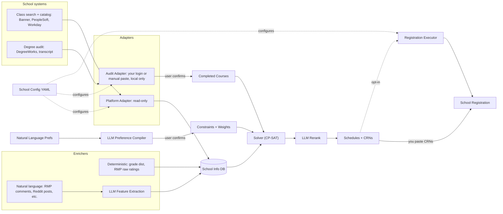

# Architecture



## Pipeline

Each stage reads the previous stage's output. Status in brackets.

1. **Fetch** [done]: the platform adapter downloads every section of a term from the school, raw and untouched. Network.
2. **Raw snapshot** [done]: saved as `data/raw/<school>/<term>.json` with `fetched_at`. This is the source of truth. Everything after this runs offline.
3. **Normalize** [done]: the adapter turns raw sections into canonical `Section` models (meetings, modality, tags, attribute codes, instructors). Bad sections are logged and skipped, never fatal.
4. **Store** [next]: normalized sections go into the DB (SQLite locally, Postgres on a server).
5. **Enrich** [later]: deterministic enrichers (grade distributions, RMP ratings) write straight to the DB; natural-language enrichers (RMP comments, Reddit) go through LLM feature extraction first. Instructor entity resolution links them to sections.
6. **Requirements + preferences** [later]: completed courses (audit adapter, user confirms) and natural-language preferences (LLM preference compiler, user confirms) become constraints and weights.
7. **Solve** [later]: CP-SAT builds the top-k schedules with backup sections. Hard constraints: time conflicts, credits, prereqs, campus, restrictions.
8. **Rerank + output** [later]: the LLM reranks and explains the top-k; output is the CRN list per schedule.

Fetch is the only stage that talks to the school. You fetch once per snapshot, then re-run any later stage as often as you want. When the models change, you re-normalize from the snapshot, you don't refetch.

## Code organization

```
RegisterHelper/
├── README.md
├── LICENSE.md
├── pyproject.toml / uv.lock
├── alembic.ini
├── migrations/                  # Alembic: the only thing that changes the schema
├── school_configs/
│   ├── gsu.yaml                 # base_url, platform: banner9.gsu, ...
│   └── ksu.yaml                 # platform: banner9.ksu
├── samples/
│   ├── banner9/gsu/             # captured Banner responses, for offline dev
│   └── banner9/ksu/
├── devnotes/
│   ├── Specs.md
│   └── TODO.md
├── data/                        # gitignored: raw snapshots + registerhelper.db
└── src/registerhelper/
    ├── cli.py                   # `rh`: terms, fetch, normalize
    ├── settings.py              # pydantic-settings (RH_ env vars), paths anchored to the project root
    ├── config.py                # loads school_configs/*.yaml
    ├── models.py                # canonical models: Term, Section, Meeting, ...
    ├── raw_data.py              # save_raw / load_raw
    ├── adapters/
    │   ├── __init__.py          # load_plugins(): imports the built-in adapters + installed plugins so they register
    │   ├── platform_adapter.py  # PlatformAdapter ABC + @register_platform
    │   └── banner9/
    │       ├── banner9.py       # Banner 9: everything Banner-wide
    │       ├── gsu.py           # GSU: Banner 9 + GSU's own codes
    │       └── ksu.py           # KSU: Banner 9 + KSU's own codes
    └── db/
        ├── session.py           # engine + get_session()
        └── tables.py            # SQLAlchemy tables
```

Later, each as its own package when its stage starts: `enrichers/`, `resolution/` (instructor matching), `requirements/`, `solver/`, `llm/`, `api/` (FastAPI), `jobs/` (scheduled fetches, seat watcher).

## Adapters

- `PlatformAdapter` is an ABC, so a plugin writer who forgets a method gets an error when the class loads, not at runtime later. Methods: `list_terms`, `fetch_sections` (network, returns `RawSection`s), `normalize_sections` (offline, returns `Section`s).
- `@register_platform("name")` registers an adapter; the school config's `platform:` picks it (`banner9.gsu`).
- `load_plugins()` (in `adapters/__init__.py`, called once at CLI startup) imports every module under `adapters/`, so a new built-in adapter only needs its file. Outside plugins declare their module in the `registerhelper.adapters` entry point group in their own `pyproject.toml`; a broken plugin is logged and skipped, a broken built-in fails loudly.
- **Banner-wide vs school-specific.** `banner9.py` only holds what is the same at every Banner 9 school: the JSON shapes, HHMM times, weekday booleans, "(View Only)" on closed terms, the session flow (`/term/search`, `resetDataForm`, pages of 500). Every code a school defines itself (attribute codes, instructional methods, meeting types, schedule types, campus names) goes in a `BannerCodes` model that the school subclass sets (`gsu.py`). Behavior that differs per school is a method override, not a code table. Never hardcode a school's codes in `banner9.py`.
- Banner's raw shapes are private pydantic models inside the adapter (`extra="ignore"`, `alias_generator=to_camel`), so nothing outside the adapter knows Banner's format.
- The audit adapter (degree audit) is a separate adapter type, later: different system, needs the user's login, local only.

## Models

`models.py`, pydantic, platform-neutral, small on purpose: a field gets added when a stage needs it.

- `Section`: term, section id (Banner: CRN), course, section number, credits, campus, modality, seats, link group, tags, attribute codes, instructors, meetings.
- `Meeting`: days, start/end (local wall-clock time, `None` when there's no fixed time), start/end dates (so mini-mesters only conflict when dates overlap), location.
- `tags` are normalized meaning (`honors`, `perimeter`, `online`, `individualized`...). `attribute_codes` are the school's raw codes; at GSU they're mostly degree-requirement areas, for the requirements stage.
- `RawSection = dict[str, JSON]`: no explicit `Any` anywhere.
- Credits are floats; the solver scales them to integers (CP-SAT is integer-only). The timezone lives on the school config, not on each meeting.

## Storage

- **Raw snapshots:** JSON files, the source of truth.
- **DB:** SQLAlchemy 2.0, portable types only (SQLite locally, Postgres on a server with the same code). Tables carry a `school` column. Normalized data is rebuildable from snapshots; user-created data (instructor match overrides, etc.) is what migrations protect. Alembic is the only thing that changes the schema, never `create_all()`.

## Requirements and degree audit (later)

- **Individual progress:** comes from the student's DegreeWorks audit or transcript, pasted manually. A programmatic fetch needs the student's session cookie, so it runs locally only, like the registration executor.
- **General program requirements:** come from the school's public catalog, not DegreeWorks.
- **Prereqs and coreqs:** Banner's per-section endpoints, fetched only for the courses being scheduled (one request per section). They tie labs to lectures at schools without section linking (GSU).
- **Choices** ("2 of these 5 electives"): the engine lists the options; the user picks.
- Until this stage exists, the solver takes a course list from the user.

## Instructor resolution (later)

An instructor appears under different names in each source ("La Corte, Julie" in Banner, a preferred name on RMP, "J. LaCorte" in grade data).

1. **Deterministic match first:** normalized name, then last name + first initial + department + school.
2. **LLM for the ambiguous remainder only**, with context (department, courses taught). Output: a match and a confidence.
3. **Every decision is stored** as a match row the user can override (user-created data, protected by migrations). Each pair is decided once; later runs read the stored row, so matching is reproducible.

## Categories and scoring (later)

Preferences and enrichment meet in one catalog of categories. The catalog is the same for every school and doesn't depend on any one source.

- **Categories:**
  - schedule shape: earliest start, latest end, days on campus, gaps, back-to-back classes at different campuses, credit total
  - section facts: modality, campus
  - instructor style: quality, difficulty, homework load, grading clarity, participation, group projects, reading load, caring... RMP's tag list is the template for these, not their source.
  - course outcomes: A rate, DFW rate
- **Evidence, not sources:** an enricher contributes evidence to categories. RMP tags, RMP comments, Reddit posts and grade data are separate enrichers feeding the same categories. Comment text counts as evidence even when the reviewer picked no tag. Each value carries how many data points support it, so a category backed by two comments counts less than one backed by fifty.
- **Normalization:** each category has a fixed rule in the catalog that maps its raw value to an integer score from 0 to 100 per schedule, where 100 is best for the requested direction. "Avoid" uses 100 − score. Section-level categories are averaged over the schedule, weighted by credits. Ranges are fixed in the catalog, not taken from the term's data, so a schedule's score doesn't change with the snapshot.

  | Category | Raw unit | Rule |
  |---|---|---|
  | gaps | minutes per week | 0 min → 100, 600+ min → 0, linear |
  | early_start | earliest start time | 10:00 or later → 100, 8:00 or earlier → 0 |
  | days_on_campus | 1–5 days | 1 day → 100, 5 days → 0 |
  | prof_quality | evidence from any enricher | worst → 0, best → 100, credit-weighted average |

- **Strengths:** a soft preference is low, medium or high. Code maps them to weights 1, 3 and 9. Hard is a constraint, not a weight. The same strength gives the same weight in every category, which only works because every category is on the same 0–100 scale. The objective is `Σ weight × score`.
- **Example:** "I really don't want early classes, I'd kind of like Fridays off, and absolutely nothing after 6pm" compiles to:
  - `early_start`, avoid, high (9)
  - `day_off(Fri)`, prefer, low (1)
  - `latest_end ≤ 18:00`, hard

  The same text always gives the same weights.
- **The catalog changes only in code:** a new category comes with its normalization rule and an enricher that fills it. Categories are never created at runtime.
- **Lexicographic priorities (potential feature):** the user ranks preferences instead of giving strengths. The solver optimizes the first, then the next within a tolerance of the previous optimum.

## Preference compiler (later)

Free-form input, typed output, frozen after user confirmation.

1. **Typed constraints (pydantic):** time windows, days off, prefer/avoid instructor, campus, modality, max gap between classes, credit range, compactness. Each soft constraint targets a category in the catalog. The compiler only activates categories the request actually matches; it never creates one.
2. **One escape hatch:** a filter on known section fields (`location contains "Langdale"`). Validated like the others, never arbitrary code.
3. **Hard or soft:** each constraint is hard, or soft with a strength (low, medium, high). The user can change either before confirming.
4. **No approximations:** a request the types can't express is reported as such. Taste ("a chill professor") goes to the rerank stage as a soft criterion. Unmatched requests are logged; the log shows which categories the catalog is missing.
5. **Compile once, freeze:** text → constraints is the only nondeterministic step. Hosted LLMs aren't deterministic even at temperature 0, so the stored output is what makes results reproducible. Its confirmed output is stored, and the solver always reads the stored version, so the same confirmed preferences always give the same schedules. Changing the wording triggers a recompile.
6. **Eval set:** phrases with their expected constraints, run whenever the prompt or model changes.

## Solver (later)

- CP-SAT, integers only: credits are scaled, and category scores are already integers from 0 to 100.
- Deterministic for a given snapshot and confirmed preferences: a fixed seed, deterministic search settings, and a final tie-break on CRN order. Without these, several workers or a time limit can return a different schedule among equally good ones.

## LLM layer (later)

`llm/`, built like the platform adapters: tasks with typed schemas, providers behind an interface.

| Task | Volume | Errors caught by | Default model |
|---|---|---|---|
| Preference compiler | once per user per term, then frozen | the user, at confirmation | large general LLM, schema-constrained output |
| Comment feature extraction | thousands to hundreds of thousands of comments, offline batches | nobody (goes straight to the DB) | zero-shot model to start, then a model fine-tuned on hand labels; picked by the eval set |
| Rerank / explain | once per solve | the user reads it | hosted LLM |
| Instructor resolution leftovers | small | stored match rows, user can override | hosted LLM |

- **Each task has:**
  - a pydantic input and output schema
  - a prompt version
  - a model id
  - a stored result, keyed by (task, prompt version, model, input hash)
- **Providers:** a hosted API, a local open-weights model, or a local encoder classifier. Switching provider is a config change, and the task's eval set decides whether a switch is allowed.
- **Validation behind every task:**
  - output is constrained to catalog ids
  - fields are checked against the DB: professor names, course codes, times
  - extraction quotes the comment text that supports each label, and code checks that the quote is in the comment
  - the compiler's output is confirmed by the user

  A weaker model then shows up as missed preferences or evidence, not invented ones.
- **Compiler model:** the language is open and combined ("only MWF if it's online"), the volume is tiny, and no training data exists. A large general model is the default. Small local models are optional behind the same interface if they pass the eval set. Extractive models (NuExtract) only output text that appears in the input, so they need deterministic code to normalize their spans ("before 10" → `early_start ≥ 10:00`).
- **Extraction model:** aspect-category sentiment analysis. The categories are fixed by the catalog, and each comment gets a polarity per category it mentions ("homework load: negative"), plus the quoted text that supports it. Existing models trained on professor reviews only cover overall sentiment, and none uses these categories.
  - **Zero-shot is the cold start only.** The end state is a model fine-tuned on the hand-labeled comments: a DeBERTa/ModernBERT pair classifier, (sentence, category) → none / low / high. SetFitABSA extracts aspect terms, not fixed categories, so it doesn't fit directly. With moderate labeled data, fine-tuned encoders match or beat zero-shot LLMs at a fraction of the cost.
  - **Candidates, compared on the eval set:**
    - a hosted large LLM: the quality ceiling, and the labeler for the training set
    - Qwen3-Reranker or Qwen3-4B/8B, run locally: the strongest zero-shot families in an independent benchmark (BTZSC)
    - GLiNER2: classification and span extraction in one call (label plus evidence), about 205M parameters, CPU
    - GLiClass: fast zero-shot classification over runtime labels; its benchmarks are reported only by its authors

    NLI cross-encoders are left out: they plateau as the backbone grows.
  - **No published benchmark covers this task.** Available comparisons are single-label, so only the eval set decides.
  - **Negation and sarcasm** are the usual failure ("the homework is light lol, NOT"). The eval set includes them.
  - **Volume doesn't decide the model.** Each comment is extracted once and keyed by its hash, so a cheap hosted model, or a local 8B model on a GPU, is feasible for every comment at a few schools. On CPU only, an 8B model is limited to the eval set.
- **Eval sets:**
  - about 200 hand-labeled comments, including negative cases ("not much homework")
  - compiler phrases with their expected constraints

## Stack

| Layer | Choice |
|---|---|
| Language / tooling | Python 3.13, uv, ruff, basedpyright |
| HTTP | httpx, polite delay between requests |
| Models / validation | pydantic, pydantic-settings |
| CLI | Typer (`rh`) |
| DB | SQLAlchemy 2.0, SQLite → Postgres, Alembic |
| Solver | OR-Tools CP-SAT |
| API | FastAPI (later) |
| Jobs | arq + Redis (later) |
| Checks | pre-commit (gitleaks, ruff), CI (ruff, basedpyright, pip-audit) |
