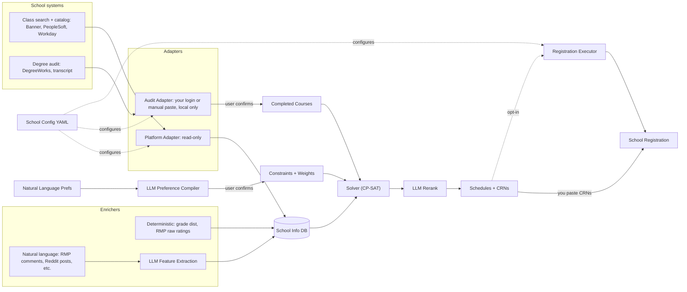

# Architecture



## Pipeline

Each stage reads the previous stage's output. Status in brackets.

1. **Fetch** [done]: the platform adapter downloads every section of a term from the school, raw and untouched. Network.
2. **Raw snapshot** [done]: saved as `data/raw/<school>/<term>.json` with `fetched_at`. This is the source of truth. Everything after this runs offline.
3. **Normalize** [done]: the adapter turns raw sections into canonical `Section` models (meetings, modality, tags, attribute codes, instructors). Bad sections are logged and skipped, never fatal.
4. **Store** [next]: normalized sections go into the DB (SQLite locally, Postgres on a server).
5. **Enrich** [later]: deterministic enrichers (grade distributions, RMP ratings) write straight to the DB; natural-language enrichers (RMP comments, Reddit) go through LLM feature extraction first. Instructor entity resolution links them to sections.
6. **Requirements + preferences** [later]: completed courses (audit adapter, user confirms) and natural-language preferences (LLM preference compiler, user confirms) become constraints and weights.
7. **Solve** [later]: CP-SAT builds the top-k schedules with backup sections. Hard constraints: time conflicts, credits, prereqs, campus, restrictions.
8. **Rerank + output** [later]: the LLM reranks and explains the top-k; output is the CRN list per schedule.

Fetch is the only stage that talks to the school. You fetch once per snapshot, then re-run any later stage as often as you want. When the models change, you re-normalize from the snapshot, you don't refetch.

## Code organization

```
RegisterHelper/
├── README.md
├── LICENSE.md
├── pyproject.toml / uv.lock
├── alembic.ini
├── migrations/                  # Alembic: the only thing that changes the schema
├── school_configs/
│   └── gsu.yaml                 # base_url, platform: banner9.gsu, ...
├── samples/
│   └── banner9/gsu/             # captured Banner responses, for offline dev
├── devnotes/
│   └── Specs.md
├── data/                        # gitignored: raw snapshots + registerhelper.db
└── src/registerhelper/
    ├── cli.py                   # `rh`: terms, fetch, normalize
    ├── settings.py              # pydantic-settings (RH_ env vars), paths anchored to the project root
    ├── config.py                # loads school_configs/*.yaml
    ├── models.py                # canonical models: Term, Section, Meeting, ...
    ├── raw_data.py              # save_raw / load_raw
    ├── adapters/
    │   ├── __init__.py          # load_plugins(): imports the built-in adapters + installed plugins so they register
    │   ├── platform_adapter.py  # PlatformAdapter ABC + @register_platform
    │   └── banner9/
    │       ├── banner9.py       # Banner 9: everything Banner-wide
    │       ├── gsu.py           # GSU: Banner 9 + GSU's own codes
    │       └── ksu.py           # KSU: Banner 9 + KSU's own codes
    └── db/
        ├── session.py           # engine + get_session()
        └── tables.py            # SQLAlchemy tables
```

Later, each as its own package when its stage starts: `enrichers/`, `resolution/` (instructor matching), `requirements/`, `solver/`, `llm/`, `api/` (FastAPI), `jobs/` (scheduled fetches, seat watcher).

## Adapters

- `PlatformAdapter` is an ABC, so a plugin writer who forgets a method gets an error when the class loads, not at runtime later. Methods: `list_terms`, `fetch_sections` (network, returns `RawSection`s), `normalize_sections` (offline, returns `Section`s).
- `@register_platform("name")` registers an adapter; the school config's `platform:` picks it (`banner9.gsu`).
- `load_plugins()` (in `adapters/__init__.py`, called once at CLI startup) imports every module under `adapters/`, so a new built-in adapter only needs its file. Outside plugins declare their module in the `registerhelper.adapters` entry point group in their own `pyproject.toml`; a broken plugin is logged and skipped, a broken built-in fails loudly.
- **Banner-wide vs school-specific.** `banner9.py` only holds what is the same at every Banner 9 school: the JSON shapes, HHMM times, weekday booleans, "(View Only)" on closed terms, the session flow (`/term/search`, `resetDataForm`, pages of 500). Every code a school defines itself (attribute codes, instructional methods, meeting types, schedule types, campus names) goes in a `BannerCodes` model that the school subclass sets (`gsu.py`). Behavior that differs per school is a method override, not a code table. Never hardcode a school's codes in `banner9.py`.
- Banner's raw shapes are private pydantic models inside the adapter (`extra="ignore"`, `alias_generator=to_camel`), so nothing outside the adapter knows Banner's format.
- The audit adapter (degree audit) is a separate adapter type, later: different system, needs the user's login, local only.

## Models

`models.py`, pydantic, platform-neutral, small on purpose: a field gets added when a stage needs it.

- `Section`: term, section id (Banner: CRN), course, section number, credits, campus, modality, seats, link group, tags, attribute codes, instructors, meetings.
- `Meeting`: days, start/end (local wall-clock time, `None` when there's no fixed time), start/end dates (so mini-mesters only conflict when dates overlap), location.
- `tags` are normalized meaning (`honors`, `perimeter`, `online`, `individualized`...). `attribute_codes` are the school's raw codes; at GSU they're mostly degree-requirement areas, for the requirements stage.
- `RawSection = dict[str, JSON]`: no explicit `Any` anywhere.
- Credits are floats; the solver scales them to integers (CP-SAT is integer-only). The timezone lives on the school config, not on each meeting.

## Storage

- **Raw snapshots:** JSON files, the source of truth.
- **DB:** SQLAlchemy 2.0, portable types only (SQLite locally, Postgres on a server with the same code). Tables carry a `school` column. Normalized data is rebuildable from snapshots; user-created data (instructor match overrides, etc.) is what migrations protect. Alembic is the only thing that changes the schema, never `create_all()`.

## Stack

| Layer | Choice |
|---|---|
| Language / tooling | Python 3.13, uv, ruff, basedpyright |
| HTTP | httpx, polite delay between requests |
| Models / validation | pydantic, pydantic-settings |
| CLI | Typer (`rh`) |
| DB | SQLAlchemy 2.0, SQLite → Postgres, Alembic |
| Solver | OR-Tools CP-SAT |
| API | FastAPI (later) |
| Jobs | arq + Redis (later) |
| Checks | pre-commit (gitleaks, ruff), CI (ruff, basedpyright, pip-audit) |
